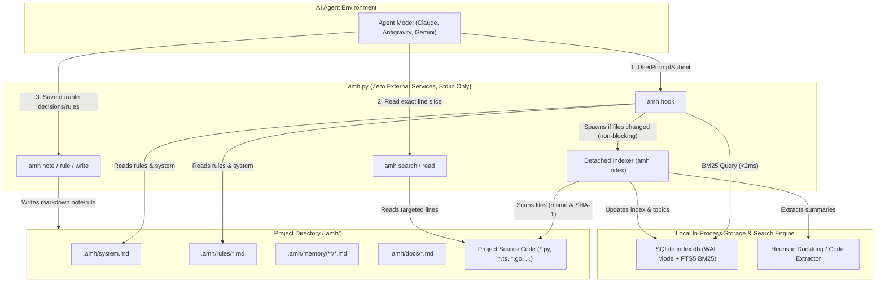
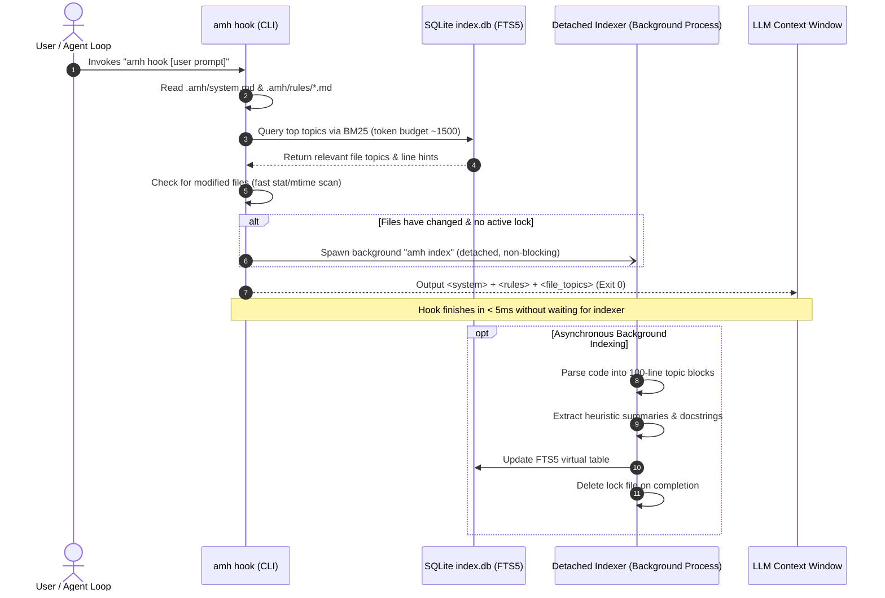
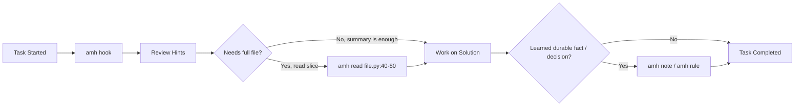

# Architecture & Design of amh (AI-MEMORY-HOOK)

`amh` is an in-process, zero-external-service memory hook and topic index designed for AI coding agents.

---

## 1. System Architecture

---

## 2. Non-Blocking Hook Lifecycle

The agent prompt is never delayed. Context is returned in `<5ms` from the existing index, while changed files are indexed in a detached background worker.

---

## 3. Agent Autonomous Read/Write Feedback Loop

How the agent navigates code and persists durable knowledge:

---

## 4. Key Components

- **Storage**: `.amh/index.db` (SQLite with Write-Ahead Logging `WAL` mode).
- **Search Engine**: SQLite `fts5` virtual table with BM25 ranking (`bm25(topics, 10.0, 10.0, 2.0, 1.0)`).
- **Query Parser**: Splits camelCase and snake_case tokens with prefix wildcard matching (`"term"*`).
- **Summarizer**: In-process regex extractor for docstrings, markdown headers, and opening comments.
- **Detached Indexer**: Spawns detached OS process with PID lock file and heartbeat monitoring.
